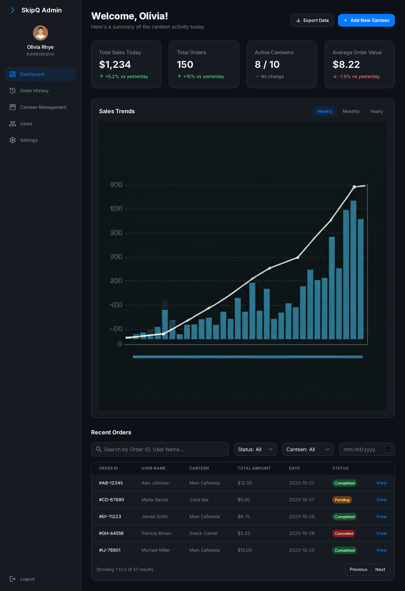
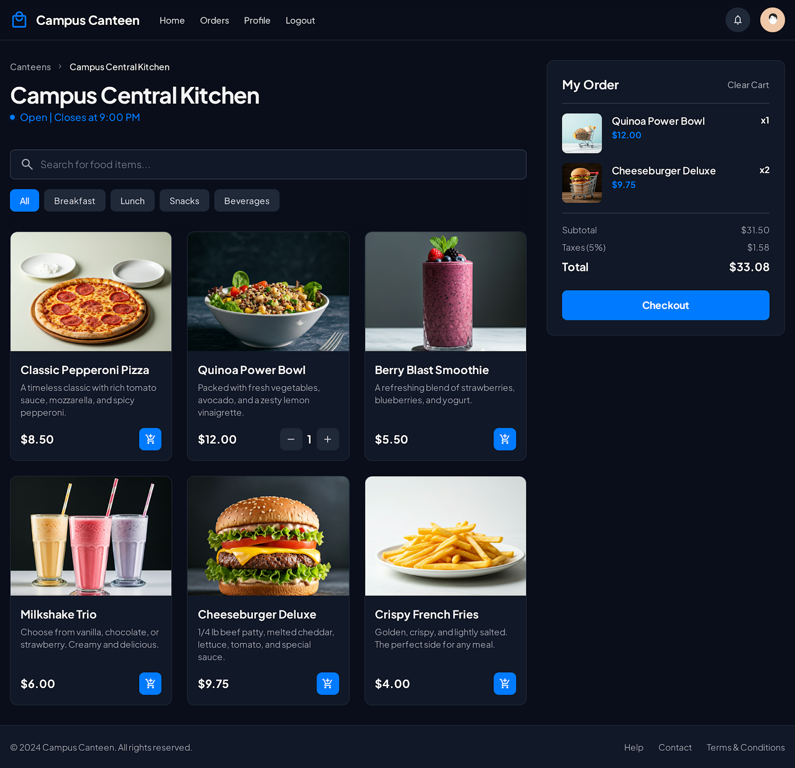

# SkipQ

**Order ahead, skip the queue.** SkipQ lets students order and pay from their phone and pick food up when it's ready, instead of standing in line at the canteen.

**In production:** 20+ campus canteens and food outlets, including Nescafé and KitKat outlets, with 500+ live orders processed.

`Next.js` `React Native (Expo)` `TypeScript` `Prisma` `MongoDB` `Razorpay` `Tailwind CSS`

| Vendor / admin dashboard | Canteen menu |
| --- | --- |
|  |  |

## What it does

**For students (mobile app + web)**
- Browse canteens and menus, search, build a cart
- Pay online with Razorpay
- Choose preorder (pick up at a set time) or self order
- Track order status until it's ready for pickup

**For vendors**
- Incoming order queue: confirm or cancel, set preparation time
- Optional WhatsApp notifications for new orders

**For admins**
- Manage canteens, vendors and menus
- Sales totals, platform commission and recent orders across all outlets

## Repository layout

| Path | What's inside |
| --- | --- |
| `college-canteen-portal/` | Next.js web app: student ordering, vendor dashboard, admin dashboard, API, Prisma schema |
| `mobile/` | React Native (Expo) student app |
| `admin_dashboard/`, `canteen_menu_display/`, `canteen_selection_dashboard/`, `order_confirmation/`, `user_login/` | Screen designs |
| `docs/` | Launch audit, UX audit and performance reports |

## Running locally

Web app:

```bash
cd college-canteen-portal
# create .env with DATABASE_URL (MongoDB)
npm install
npx prisma generate
npm run db:seed
npm run dev                 # http://localhost:3000
```

Mobile app:

```bash
cd mobile
npm install
npx expo start
```

See `college-canteen-portal/README.md` for demo logins and environment variables.
